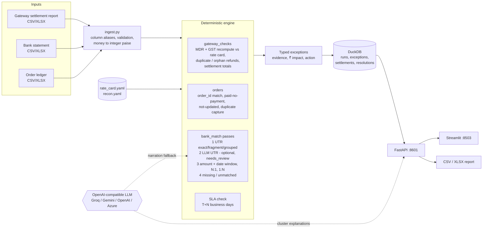

# ReconLens

AI-assisted payment settlement reconciliation for Indian SMB and D2C merchants.

ReconLens takes the three files a finance-ops person reconciles by hand every week (the payment gateway's settlement report, the bank statement and the store's order ledger). It matches them with a deterministic engine and returns a typed exception queue. Every exception carries its evidence rows, a rupee impact and a suggested action. An LLM is used only at the edges, where rules run out: messy bank narrations, and plain-English write-ups and draft emails. Everything works with the LLM switched off.

The data in this repo is synthetic and uses a fictional gateway called **PayFlow**. No real gateway's name, branding or report format is used.

## The problem and who has it

**Who:** finance executives and founders at Indian D2C brands and SMBs that take online payments through a payment gateway, typically a few hundred to a few thousand prepaid orders a day. Most have no reconciliation tool, just Excel.

**What they do today, every week:**
1. Export the gateway's settlement report. It has one row per payment, refund or chargeback, with the MDR fee, the 18% GST on that fee, the settlement id, the settlement date and the UTR of the payout.
2. Download the bank statement, where each payout appears as one credit with a free-text narration, e.g. `NEFT CR-PAYFLOW PAYMENTS PVT LTD-SETTL 0412-UTIBN26034001234`. The narration is often truncated or reformatted, or has no UTR at all.
3. Export orders from the store backend.
4. VLOOKUP order_id between the ledger and the gateway, then sum each settlement batch and find the matching bank credit. After that, chase whatever does not tie out.

The bulk lookups are quick. The time goes on what does not match: a payout that never arrived, a credit ₹2,340 short, a batch paid in two transfers, a narration with no UTR, a refund the store never recorded, or a card fee at 2.36% when the contract says 1.95%. Most of these discrepancies are only found if someone recomputes each line.

### How big is the pain? (an estimate, with the assumptions shown)

These are illustrative assumptions for one mid-size merchant, not measured market statistics. Change them to fit your case.

| assumption | value |
|---|---|
| prepaid orders per day | 1,000, so about 30,000 payments a month |
| share of lines a human must look at individually (no clean lookup) | 2% to 5% |
| minutes per manual investigation | 3 to 5 |
| settlement batches per month | about 25 per merchant account |

- **Time:** 30,000 × 2–5% = 600–1,500 lines a month, at 3–5 minutes each, comes to **30–125 hours a month**. That is roughly 0.2–0.8 of a finance executive's month spent on matching rather than on fixing problems.
- **Leakage:** individual per-payment fee errors are small. At an average ticket of ₹1,000, a 0.4-percentage-point overcharge costs ₹4 plus GST per payment. The expensive cases are systematic ones:
  - A pricing-plan misconfiguration charging every card payment 0.4 pp too much costs **₹40,000 plus GST per ₹1 crore of card volume** each month.
  - One missed or short payout is a whole day's net settlement, which is lakhs of rupees at this scale and goes unnoticed until someone ties out the bank.
- These costs scale with volume, and the work is weekly, so a v1 that removes the matching and surfaces only real exceptions with evidence pays back quickly.

## What v1 does

1. **Synthetic data generator** (seeded; up to 100k+ payments):
   - Models T+1/T+2 settlement cycles, Sundays, 2nd/4th Saturdays and bank holidays, and multiple merchant accounts.
   - Builds batch settlements that net payments against MDR, GST, refunds and chargebacks.
   - Injects 13 types of known discrepancy and writes them out as gold labels.
2. **Deterministic reconciliation engine** (pandas, integer paise, no LLM). Multi-pass matching:
   - exact or fragment UTR
   - grouped UTR, which covers merged and split payouts
   - amount plus a business-day window with mutual uniqueness
   - N:1 and 1:N subset sums
   - order↔payment matching on order_id
   - fee and GST recomputation against a YAML rate card

   It produces 18 typed exception types, each with evidence, a ₹ impact and a suggested action. Runs are idempotent.
3. **LLM layer** (optional, OpenAI-compatible):
   - (i) Extracts the UTR from narrations the regex could not parse. The output is validated by Pydantic and has a confidence threshold, and the extracted UTR must also tie out on amount. Matches from this path are always marked `needs_review`.
   - (ii) Writes a plain-English explanation and next step per exception cluster, with a draft email to the gateway for recoverable money. Citations are checked against the evidence ids the model was given.

   With no LLM configured, the rule-based templates take over for (ii) and the narration fallback is skipped.
4. **FastAPI service:** create runs (upload CSV/XLSX or use demo data), browse and filter exceptions, resolve or annotate them, export CSV/XLSX, and `/health` plus `/ready`.
5. **Streamlit UI** for finance ops:
   - summary metrics: auto-match rate, ₹ reconciled vs unreconciled, ₹ recoverable, and exceptions by type and age
   - an exception queue with evidence and explanations, resolve/annotate actions and report download
   - a business-impact panel whose time-saved figure uses an editable minutes-per-match assumption and is labelled as an estimate
6. **Evaluation:** `python -m reconlens.eval` reports precision/recall per discrepancy type, auto-match rate, false-match rate, runtime at 10k and 100k, and the narration extraction rate.

## Architecture



Code map (`src/reconlens/`):

| module | what it does |
|---|---|
| `datagen/` | seeded generator and gold labels (`python -m reconlens.datagen`) |
| `ingest.py` | CSV/XLSX loading, column aliases, validation errors with row numbers |
| `money.py`, `bankcal.py` | paise math (half-up fee/GST), Indian bank working-day calendar |
| `narration.py` | UTR regexes and the exact/suffix UTR index |
| `engine/` | `gateway_checks`, `orders`, `bank_match`, `core.reconcile()`, and the exception taxonomy in `types.py` |
| `llm/` | HTTP client with retries, Pydantic schemas, narration extractor, cluster explanations |
| `store.py`, `service.py` | DuckDB persistence, run fingerprinting and reuse |
| `api/` | FastAPI app (`create_app()` factory, `main:app`) |
| `ui/` | Streamlit dashboard (talks to the API over HTTP) |
| `eval/` | metrics and the eval CLI |

## Quickstart

### Docker

```bash
cp .env.example .env          # optional; the defaults run with the LLM off
docker compose up -d --build
```

| service | host port | what it is |
|---|---|---|
| `api` | **8601** | FastAPI. Docs at http://localhost:8601/docs, plus `/health` and `/ready`. The DuckDB file lives on the `reconlens-data` volume. |
| `ui` | **8503** | Streamlit dashboard at http://localhost:8503. It starts only after the API is healthy and calls it at `http://api:8601`. |

Both containers run from one image (`python:3.12-slim` with dependencies installed by `uv sync --frozen`), as a non-root user, with Docker health checks. Stop and remove everything, including the data volume, with `docker compose down -v`.

**Verified on this machine (2026-11-04)** with `docker compose up -d --build`:
- Both containers reported `healthy`; `/health`, `/ready` and the UI's `/_stcore/health` and `/` all returned 200.
- `POST /runs -F demo=true` (5,000 payments) completed with a 96.14% payment auto-match rate, 81 exceptions and ₹4,59,083.05 recoverable. Engine runtime was 0.46 s inside the container.
- Posting the same request again returned `reused: true`.
- Filtering exceptions to `mdr_overcharge` and resolving one worked. CSV and XLSX exports downloaded, and `/explain` returned template explanations for 13 clusters with the LLM disabled.
- Re-confirmed after the final changes: the same run id and the same results, with a 0.24 s engine runtime. Both times the stack was shut down afterwards with `docker compose down -v`.

### Local (uv)

```bash
uv sync
uv run uvicorn reconlens.api.main:app --port 8601                  # API
uv run streamlit run src/reconlens/ui/app.py --server.port 8503     # dashboard
```

The dashboard finds the API through `API_URL` (default `http://localhost:8601`). `RECONLENS_UI_MODE` controls what happens if the API is not reachable:

| `RECONLENS_UI_MODE` | behaviour |
|---|---|
| `api` | always call the HTTP API at `API_URL`, and show an error with a Retry button if it is unreachable (what docker compose uses) |
| `local` | run the same FastAPI app in-process, so no API server is needed; it uses an in-memory DuckDB unless `RECONLENS_UI_LOCAL_DB` is set |
| `auto` (default) | try `API_URL` first, then fall back to `local` |

In every mode the dashboard goes through the API contract. It never calls the engine directly.

Generate a dataset to upload:

```bash
uv run python -m reconlens.datagen --payments 10000 --out data/demo
# writes gateway_report.csv, bank_statement.csv, order_ledger.csv, gold.json
```

## Dashboard

Pick a source in the sidebar: **use demo data** (with the number of payments and a seed), or upload the three files as CSV or XLSX. Then run the reconciliation. Earlier runs can be reopened from the sidebar. Running the same inputs again reuses the existing run.

| tab | what it shows |
|---|---|
| **Overview** | KPI tiles: auto-match rate, ₹ reconciled, ₹ unreconciled, ₹ recoverable, and ₹ lost to fee and GST overcharges. Below them, the statement date and the settlement auto-match rate, then exception charts by type and by age bucket. A toggle shows unresolved exceptions only. |
| **Exception queue** | A filterable queue (type, severity, status, age bucket, minimum impact, recoverable only, free-text search over ids, keys and UTRs). It is sorted by severity and ₹ impact. Each exception has its evidence rows grouped by source (gateway, settlement, bank, ledger), and LLM-assisted matches carry a `needs review` flag. Each also has an explanation and next step, with a draft email to the gateway for recoverable items. That text comes from the LLM when one is configured and from a rule-based template otherwise. A resolve form sets the status (open, in progress, resolved, ignored) and records a note and who handled it. |
| **Download** | The full exceptions report as CSV, or as Excel with a settlements sheet, served by the API. You can also download just the filtered queue. |
| **Business impact** | An estimate that is labelled as one. Hours saved = auto-matched items (reconciled payments plus auto-matched settlements) × an editable "minutes per manual match". A second editable figure, minutes per exception, estimates the investigation work that is left. |

## Configuration

- `config/rate_card.yaml`: the contracted pricing per method (percent, flat fee, minimum fee, T+N settlement days) and the GST rate.
- `config/recon.yaml`:
  - tolerances: per-payment fee/GST slack, settlement-vs-credit tolerance (₹1.00), credit window, SLA grace and missing grace
  - the gateway keywords that mark a bank credit as gateway-related
  - bank holidays
- Environment (`.env`, via pydantic-settings): see `.env.example`, which has ready-to-uncomment presets for Groq, Gemini, OpenAI and Azure OpenAI. The LLM settings are:
  - `LLM_PROVIDER` = `none | groq | gemini | openai | azure | custom`
  - `LLM_API_KEY`
  - optionally `LLM_MODEL` and `LLM_BASE_URL`
  - `LLM_API_VERSION` (Azure only)
  - timeouts and retries

**Free Groq key:** sign up at https://console.groq.com, open *API Keys*, then *Create API Key*. Then set `LLM_PROVIDER=groq` and `LLM_API_KEY=gsk_...` in `.env`. The default model is `llama-3.3-70b-versatile`. You can use `LLM_MODEL=llama-3.1-8b-instant` for a higher free-tier rate limit. For Gemini, set `LLM_PROVIDER=gemini` with a Google AI Studio key; it uses the OpenAI-compatible endpoint `https://generativelanguage.googleapis.com/v1beta/openai`.

## API examples

```bash
# run on demo data (5,000 payments by default)
curl -s -X POST localhost:8601/runs -F demo=true | jq '.run_id, .summary.auto_match_rate'

# run on your own files (CSV or XLSX)
curl -s -X POST localhost:8601/runs \
  -F gateway_file=@data/demo/gateway_report.csv \
  -F bank_file=@data/demo/bank_statement.csv \
  -F ledger_file=@data/demo/order_ledger.csv

# the same files again returns the same run (HTTP 200, "reused": true); ?force=true recomputes it in place
curl -s localhost:8601/runs/$RUN
curl -s "localhost:8601/runs/$RUN/exceptions?type=mdr_overcharge&severity=high&status=open&limit=20"
curl -s -X POST localhost:8601/exceptions/$EXC/resolve -H 'content-type: application/json' \
  -d '{"status":"resolved","note":"credit note received","resolved_by":"asha"}'
curl -s -o report.xlsx "localhost:8601/runs/$RUN/report?format=xlsx"
curl -s -X POST localhost:8601/runs/$RUN/explain        # LLM if configured, else templates
curl -s localhost:8601/health ; curl -s localhost:8601/ready
```

Errors always have the shape `{"error": {"code", "message", "details"}}`. For example, a file missing columns returns 422 with the problem list.

## Exception taxonomy

| type | key | ₹ impact | recoverable |
|---|---|---|---|
| missing_settlement | settlement_id | net payout | yes |
| short_credit / excess_credit | settlement_id | shortfall / excess | yes / no |
| mdr_overcharge | payment_id | excess fee + GST on it | yes |
| gst_mismatch | payment_id | GST charged − 18% of fee | yes |
| duplicate_refund | refund id of the repeat | refund amount | yes |
| refund_without_order | refund id | refund amount | no |
| order_paid_no_payment | order_id | order amount | no |
| payment_not_recorded | payment_id | payment amount | no |
| payment_without_order, amount_mismatch, duplicate_capture | payment_id | amount / difference | no |
| settlement_delayed | settlement_id | net payout (working capital) | no |
| narration_no_utr | bank txn id | 0 (match confirmation) | no |
| split_credit / merged_credit | settlement_id / bank txn id | 0 | no |
| rounding_difference | settlement_id | paise written off | no |
| unmatched_bank_credit | bank txn id | credit amount | no |

## Evaluation results (measured)

Command: `uv run python -m reconlens.eval --stress`. Raw output is in `eval_results/results.{md,json}`.

- **Setup:** seed 7, 120 days from 2026-01-01, 3 merchant accounts, generated data with gold labels. The data goes through the same CSV ingest path as uploads.
- **Machine:** this development laptop (12 cores, Python 3.12, pandas 3.1). Runtime covers ingest plus reconcile and excludes data generation. It is wall-clock time from a single run, so it moves with machine load. The table shows the final run, made while other jobs were running; an earlier run of the same engine on a quieter machine took 0.28 s and 1.78 s for 10k and 100k. The quality metrics were identical in both runs.

| | 10,000 payments | 100,000 payments | 10,000 stress* |
|---|---:|---:|---:|
| gateway rows / settlements / bank rows / ledger rows | 10,438 / 286 / 511 / 13,005 | 104,380 / 314 / 553 / 130,050 | 10,438 / 563 / 737 / 13,005 |
| runtime (ingest + reconcile) | 0.46 s | 2.84 s | 0.63 s |
| payment auto-match rate | 93.28% | 93.24% | 94.72% |
| settlement auto-match rate | 95.59% | 95.60% | 95.93% |
| false-match rate (settlement↔bank edges) | 0.00% (0/272) | 0.00% (0/273) | 0.00% (0/541) |
| narration UTR extraction, rule-only | 96.84% | 98.03% | 50.17% |
| narration UTR extraction, LLM-assisted | pending a live run | pending a live run | pending a live run |
| precision / recall on all 13 injected types | 1.000 / 1.000 | 1.000 / 1.000 | 1.000 / 1.000 |

\*Stress: 50% of gateway narrations have no UTR, 30% have a UTR in a non-standard format the regex cannot parse, and there are 6 merchant accounts. This forces most matches through the amount and date pass.

Per-type counts at 100k (gold = TP, with no FP or FN):
- mdr_overcharge 200, gst_mismatch 100, payment_not_recorded 100
- duplicate_refund 50, order_paid_no_payment 50, refund_without_order 30
- narration_no_utr 12, rounding_difference 9
- missing_settlement, short_credit, settlement_delayed, split_credit and merged_credit: 6 each

How to read these numbers honestly:
- **Perfect precision and recall are expected here, and they are not a claim about real-world accuracy.** The generator and the engine were written together, and every injected discrepancy type has a rule built for it. The eval shows that each rule fires on its case without false positives, at scale, through the real ingest path. It cannot show how the engine copes with discrepancy patterns nobody anticipated. Real bank and gateway files will have formats and failure modes the generator does not model.
- The amount and date pass does not cross-wire matches even in the stress run, because settlement nets differ at the paise level. Real merchants with many identical round-amount payouts would see more `ambiguous → left unmatched` cases, by design (see limitations).
- The auto-match rate is not 100% because payments belonging to missing or short settlements, or carrying their own exception, are correctly not counted as reconciled.

### Results: pending a live run

The LLM-assisted narration extraction rate and the quality of the LLM explanations need a real model key, and none was available when this was built. To produce them:

```bash
cp .env.example .env    # set LLM_PROVIDER=groq and LLM_API_KEY=...
uv run python -m reconlens.eval --stress --llm      # writes eval_results/results_llm.{md,json}
```

The hard-narration set is 8 credits at 10k and 145 in the stress run. The rule-only rate on these is 0%, so any LLM gain shows up directly in the `hard` row of `by_variant`. The test suite already checks the plumbing with a perfect fake model (`tests/test_engine_gold.py`). With that fake model, all hard narrations are recovered and every resulting match is marked `needs_review`.

## Tests

131 tests, all passing offline in about 7 s (`uv run pytest`, measured 2026-11-04).

```bash
uv run pytest            # offline, no LLM key needed
uv run ruff check src tests
```

The suite covers:
- each matching pass, including tolerance boundaries, fragments, merged/split, ambiguity and mutual uniqueness
- every exception type
- fee, GST and minimum-fee math with half-up rounding
- the bank calendar
- narration parsing
- ingest validation and XLSX
- idempotent re-runs, with resolutions surviving a forced re-run
- the LLM client's retries and Azure headers (via respx)
- the narration extractor's validation and batching, and LLM failure degrading to rules
- the explanation citation filter and template fallback
- the API end to end with an in-memory DuckDB

## CI

`.github/workflows/ci.yml` runs on every push and pull request. It runs on Ubuntu with uv and Python 3.12:
1. `uv sync --frozen`
2. `ruff check .`
3. `pytest -q`
4. a Docker image build, once the tests pass

CI needs no LLM key (`LLM_PROVIDER=none`), because every LLM path is tested with fake or scripted models and respx.

## Design decisions

- **Deterministic first, LLM only at the edges.** Reconciliation results end up in books of account and in claims against a gateway. Every match must be reproducible and explainable from evidence rows. Matching, fee math, SLA and exception typing are therefore plain code that gives the same output for the same input. The LLM handles only two things rules do badly: free text that does not follow a pattern, and prose for humans. An LLM-extracted UTR never auto-accepts a match. It must resolve to a real settlement, tie out on amount within tolerance and pass a confidence threshold, and even then it lands as `needs_review`.
- **Integer paise everywhere.** Money is parsed once into int64 paise. Fees and GST are computed with integer half-up rounding (`rate_ppm`, `gst_bps`), so there are no floating-point pennies. Tolerances are explicit config: 1 paise per payment fee, ₹1.00 per settlement.
- **Ordered passes with "don't guess" rules.** Strong evidence (a UTR) is used before weak evidence (amount and date). The amount pass needs *mutual* uniqueness: the credit has exactly one candidate settlement and that settlement has exactly one candidate credit. Subset sums are accepted only if exactly one combination fits. Ambiguous cases are left unmatched and surface as exceptions rather than as silent wrong matches.
- **Idempotent runs.** A run id is a hash of the input file bytes, the rate card and config, the engine version and the LLM flag. Re-posting the same files returns the existing run, and `force=true` recomputes it in place inside one transaction. Exception ids are `hash(run_id, type, key)`, and resolutions are stored separately by exception id, so analyst notes survive a re-run.
- **DuckDB** keeps the service a single container with no database server. A finance team's weekly volume fits easily, and the schema maps directly onto Postgres if multi-user write concurrency is ever needed.
- **The UI talks only to the API**, so the API is the single writer to DuckDB.

## Limitations

- The data is synthetic. Real gateway reports and bank statements need per-bank column mappings. The ingest layer has an alias map but has not been tested on real exports.
- One gateway and one bank account. A settlement is assumed to be paid into the account on the statement.
- A short credit is detected only when the credit can be paired with its settlement, by UTR or by a unique amount within tolerance. A short credit with no UTR shows up as a missing settlement plus an unmatched credit, and a human then pairs them.
- Bank-side UTR fragments must be at least 8 characters and unique among the settlements in the report.
- A negative net settlement (refunds greater than payments) is marked `no_payout` and is not carried forward into the next batch.
- The holiday list in `recon.yaml` is illustrative. Replace it with your bank's published calendar.
- Natural-language Q&A over results ("how much did we lose to fee overcharges in March?") is not built yet; see the roadmap.
- No authentication on the API. Run it behind your SSO or a reverse proxy.

## Roadmap

1. Bank statement ingestion from bank APIs or account aggregators and from PDF/MT940 statements, plus per-bank narration profiles.
2. Multi-gateway support: a per-gateway report adapter and rate card, with settlements from several gateways matched against one bank account.
3. Alerting: Slack or email when a payout is missing past SLA or the fee overcharge rate crosses a threshold, plus a scheduled daily run.
4. Natural-language Q&A over reconciliation results using guarded, read-only SQL (a single SELECT over an allowlisted schema in a sandboxed DuckDB connection).
5. Negative-balance carry-forward, and partial-capture and EMI pricing in the rate card.
6. A feedback loop: use resolved `needs_review` matches to tune tolerances and narration rules.

## License

MIT. See [LICENSE](LICENSE).
